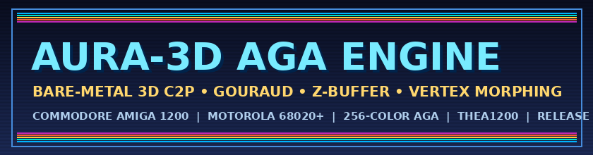
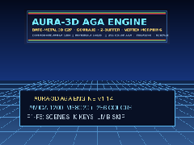
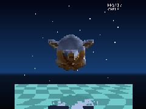
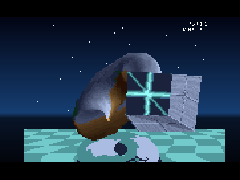
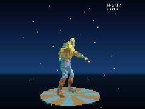

# Historia Zmian / Changelog — AURA-3D AGA Engine

## v1.14.1 (2026-11-23)
- Aktualizacja optymalizacji potoku M68020+/AGA, cieniowania Phonga, terenu 3D oraz etykiet H HELP i L LANG pod HUD FPS.

---

## Archiwum dokumentacji v1.14

  
  <h1>AURA-3D AGA Engine v1.14</h1>
  
<strong>Bare-metal 3D Software Engine for Commodore Amiga 1200 (M68020+ / AGA / 256 Colors)</strong>

  

    <a href="https://github.com/malek69/aura3d-aga-engine/releases/download/v1.14/aura3d_demo_v1.14_AGA.lha">Download .LHA</a> &bull;
    <a href="https://github.com/malek69/aura3d-aga-engine/releases/download/v1.14/aura3d_demo_v1.14_AGA_FSUAE.zip">Download FS-UAE .ZIP</a> &bull;
    <a href="https://github.com/malek69/aura3d-aga-engine/releases/download/v1.14/aura3d_demo_v1.14_AGA.adf">Download .ADF</a> &bull;
    <a href="https://github.com/malek69/aura3d-aga-engine/releases/download/v1.14/aura3d-aga-engine-v1.14-src.zip">Source .ZIP</a>
  

---

## Pobieranie / Downloads (v1.14 Latest)

| Pakiet | Przeznaczenie i platforma | Link |
| :--- | :--- | :--- |
| **`aura3d_demo_v1.14_AGA.lha`** | **WHDLoad / THEA1200 / RetroArch (PUAE) / Amiga 1200 + Fast RAM** — gotowy katalog z ikonami `.info`, WHDLoad Slave i plikiem wykonywalnym | [Pobierz .LHA](https://github.com/malek69/aura3d-aga-engine/releases/download/v1.14/aura3d_demo_v1.14_AGA.lha) |
| **`aura3d_demo_v1.14_AGA_FSUAE.zip`** | **FS-UAE Launcher / WinUAE** — paczka skonfigurowana pod emulatory Amigi 1200 AGA (`68020` + `8 MB Fast RAM`) | [Pobierz FS-UAE .ZIP](https://github.com/malek69/aura3d-aga-engine/releases/download/v1.14/aura3d_demo_v1.14_AGA_FSUAE.zip) |
| **`aura3d_demo_v1.14_AGA.adf`** | **Stacja dyskietek `DF0:` / Gotek FlashFloppy** — samostartujący obraz dyskietki 880 KB dla prawdziwej Amigi 1200 | [Pobierz .ADF](https://github.com/malek69/aura3d-aga-engine/releases/download/v1.14/aura3d_demo_v1.14_AGA.adf) |
| **`aura3d-aga-engine-v1.14-src.zip`** | **Kod źródłowy (M68020 ASM + Python)** — kompletne źródła silnika `engine/`, scen `demo_v1/` oraz konwerterów `tools/` | [Pobierz Source .ZIP](https://github.com/malek69/aura3d-aga-engine/releases/download/v1.14/aura3d-aga-engine-v1.14-src.zip) |

---

## Gallery / Galeria (8 Etapow na Prawdziwym Potoku AGA)

<table>
  <tr>
    <td align="center"> <b>1. Plansza Startowa AGA</b> (8-bitplan RLE)</td>
    <td align="center"> <b>2. Vertex Morphing</b> (1008 trojkatow)</td>
    <td align="center"> <b>3. Wahadlowiec + Flara 3D</b> (576 tris)</td>
    <td align="center"> <b>4. System Planetarny</b> (1008-tri Chrom)</td>
  </tr>
  <tr>
    <td align="center"> <b>5. Przelot przez Torus</b> (Kamera 6DOF)</td>
    <td align="center"> <b>6. Model .OBJ Suzanne</b> (968 trojkatow)</td>
    <td align="center"> <b>7. Teren 3D Heightmap</b> (Kanion + Woda)</td>
    <td align="center"> <b>8. Final 3D &amp; Orbita</b> (Postac Wektorowa)</td>
  </tr>
</table>

---

## Co mamy w wersji v1.14 / Engine Features

- **8-Bitplanowy Ekran Startowy AGA (`320x256`, 256 kolorow):** konwertowany z pliku `.png` przez `tools/png_to_aga.py` ze strumieniowa dekompresja RLE.
- **Falujaca Tafla Wody i Lustrzane Odbicia (`M`):** perspektywiczna woda z modulacja sinusoidalna oraz odbicia obiektow sortowane w 16-bitowym Z-Bufferze.
- **Rozblyski Soczewkowe 3D / Lens Flare (`L`):** promienie anamorficzne oraz 3 krazki dyfrakcyjne z testem zasloniecia w Z-Bufferze.
- **Blyski Lustrzane (Specular Highlights):** ostre refleksy swietlne na krzywiznie metalu (`transform_normals_envmap` z optymalizacja `bfextu` na M68020).
- **Teren 3D z Mapy Wysokosci (`engine/terrain_3d.i`):** proceduralny kanion `64x64` z kierunkowym cieniowaniem zboczy, blekitnymi jeziorami i osniezonymi szczytami.
- **Wielomaterialowe Siatki 3D + Konwerter `.obj` / `.png`:** obsluga do 4 tekstur `64x64` na jedna bryle (`tools/mesh_conv.py` oraz `tools/png_to_aga.py`).
- **24-bitowe Niebo Coppera (`1`-`4`), Cienie Rzucane (`C`), Mgla Glebi (`F`) i HUD FPS (`H`, `K`).

---

## Opis Wszystkich Scen (Klawisze `F1`–`F8` oraz `Tab`)

| Klawisz | Scena | Zawartosc i aktywne efekty |
| :--- | :--- | :--- |
| **`F1`** | **Plansza Tytulowa AGA** | 8-bitplanowy ekran startowy `320x256` (256 kolorow) zdekompresowany z RLE |
| **`F2`** | **Scena 1: 3D Vertex Morphing** | Plynna morfologia siatki `1008` trojkatow (Torus <-> Kula <-> Gwiazda) nad falujaca woda z cieniami |
| **`F3`** | **Scena 2: Wielomaterialowy Wahadlowiec** | Model `576` trojkatow (tytan, cyber-obwody, oslona termiczna), smuga z 2 dysz, rozblysk Lens Flare (`L`) oraz odbicie wodne (`M`) |
| **`F4`** | **Scena 3: System Planetarny** | Centralny Torus (`1008` trojkatow, satynowy chrom) + 2 teksturowane ksiezyce na orbicie i falujaca woda |
| **`F5`** | **Scena 4: Przelot Kamery przez Torus** | Pelna kamera 3D 6DOF przelatujaca przez srodek chromowanego Torusa `1008` trojkatow |
| **`F6`** | **Scena 5: Model Wavefront `.OBJ` (Suzanne)** | Siatka `968` trojkatow zaimportowana z pliku `.obj` przez `tools/mesh_conv.py` w satynowym chromie nad woda |
| **`F7`** | **Scena 6: Przelot nad Terenem 3D** | Proceduralny teren z mapy wysokosci `64x64` z cieniowaniem zboczy, blekitna woda w dolinach i przelatujacym wahadlowcem |
| **`F8`** | **Scena 7: Final 3D & Orbita** | Klasyczna bryla wektorowa 3D, gwizdziste tlo i 4-kanalowy odtwarzacz ProTracker `.MOD` |

---

## Pelna Klawiszologia / Controls

| Klawisz / Kontroler | Dzialanie |
| :--- | :--- |
| **`F1` – `F8`** | Natychmiastowy skok do wybranej sceny (od planszy startowej po final 3D) |
| **`Tab`** | Przelaczenie do kolejnej sceny w petli |
| **`K`** | Otworz / zamknij **panel klawiszologii na ekranie** |
| **`Strzalki` / Joystick Port 2** | Obrot kamery i obiektow 3D (`Yaw` / `Pitch`) |
| **`W` / `S` lub `Fire + Gora/Dol`** | Przyblizenie / oddalenie kamery (`Zoom`) |
| **`1` – `4`** | Zmiana 24-bitowego motywu nieba Coppera (Noc, Zachod slonca, Zorza, Mglawica) |
| **`M`** | Wlacz / wylacz **lustrzane odbicia 3D** na wodzie |
| **`L`** | Wlacz / wylacz **rozblyski soczewkowe 3D (Lens Flare)** |
| **`G`** | Wlacz / wylacz **falujaca tafle wody / podloge 3D** |
| **`C`** | Wlacz / wylacz **cienie rzucane 3D** (Planar Shadows) |
| **`F`** | Wlacz / wylacz **mgle glebi Z-Fog** |
| **`H`** | Wlacz / wylacz **licznik FPS HUD** |
| **`Spacja` / `R`** | Reset pozycji kamery |
| **`LMB` / `ESC`** | Wyjscie do AmigaOS / WHDLoad |

---

## Architektura i Moduly Silnika (`engine/`)

| Modul | Rola w silniku | Mechanizmy sprzetowe i algorytmy |
| :--- | :--- | :--- |
| **`gfx_engine.i`** | Inicjalizacja AGA i Coppera | Przejecie systemu (`sys_takeover`), 8 bitplanow (`320x256`, 256 kolorow), podwojne buforowanie VBL `50 Hz`, 24-bitowe niebo Coppera (`1`-`4`) |
| **`c2p_chunky.i`** | Konwersja Chunky-to-Planar | Przeliczanie bufora `160x128` (8-bit) na 8 bitplanow AGA (`320x256`) w czasie rzeczywistym na M68020+ |
| **`aura3d_v2.i`** | Glowny potok 3D i rasteryzer | Transformacje macierzowe 3D, rzutowanie perspektywiczne, cieniowanie Gourauda + UV (`bfextu`), Specular Highlights, `Z-Fog`, 16-bitowy **Z-Buffer** |
| **`ground_grid.i`** | Falujaca tafla wody 3D | Perspektywiczne skanowanie wierszy tafli z modulacja sinusoidalna (`sin_tab`), przewijaniem wzdłuż `Z` i zapisem do Z-Buffera (`G`) |
| **`mirror_reflect.i`** | Lustrzane odbicia 3D na wodzie | Symetryczne odbicie wierzcholkow pod tafla wody z falowaniem poziomym i sortowaniem glebi w Z-Bufferze (`M`) |
| **`planar_shadow.i`** | Cienie rzucane 3D | Rzutowanie geometrii na plaszczyzne podloza z testem Z-Buffera (`C`) |
| **`lens_flare.i`** | Rozblyski soczewkowe 3D | Promienie anamorficzne oraz 3 krazki dyfrakcyjne z testem zasloniecia w Z-Bufferze (`L`) |
| **`terrain_3d.i`** | Teren 3D z mapy wysokosci | Proceduralny kanion `64x64` (`360` trojkatow), kierunkowe cieniowanie nachylenia stokow, jeziora w dolinach i szczyty |
| **`particle_trail.i`** | System czasteczek 3D | Podwojna smuga spalin z dysz wahadlowca z zanikaniem jasnosci w Z-Bufferze |
| **`starfield.i`** | Gwiezdziste tlo 3D | 256 wielowarstwowych gwiazd z paralaksa glebi |
| **`hud_fps.i`** | Nakladka HUD i pomoc | Pomiar klatek na sekunde (`FPS:XX` z VBL `50 Hz`, klawisz `H`) oraz ekranowy panel klawiszologii (`K`) |
| **`input_ctrl.i`** | Klawiatura i Joystick | Bezposredni odczyt CIA-A (`$BFEC01` + impuls `ACK`) oraz portu 2 joysticka (`JOY1DAT` + `Fire`) |
| **`pt_player.i`** | Odtwarzacz ProTracker | 4-kanalowy odtwarzacz modulow `.MOD` z DMA Paula (`16 497 Hz`) |

---

## Narzedzia Deweloperskie (`tools/`)

- **`tools/mesh_conv.py`** — konwerter modeli 3D Wavefront **`.obj`** na natywne tablice wierzcholkow, normalnych i trojkatow w asemblerze M68k (`--obj`, `--prefix`, `--out`, `--radius`, `--tex`).
- **`tools/png_to_aga.py`** — konwerter obrazow **`.png`** na tekstury `64x64` chunky (`--mode texture`) lub pelnoekranowe obrazy `320x256` w 8 bitplanach AGA + 24-bitowa paleta (`--mode bitplanes`).
- **`tools/build_demo.py`** — automatyczny skrypt kompilujacy kod M68020+ (`vasmm68k_mot`), WHDLoad Slave oraz budujacy obrazy **`.adf`**, archiwa **`.lha`** i paczki **`_FSUAE.zip`**.
