
<a href="README.md">Polski</a> | <a href="README_EN.md">English</a> | <a href="CHANGELOG.md">Historia Zmian (PL)</a> | <strong>Changelog (EN)</strong>

# Changelog

## [v1.14.4.2] - 2026-11-24
- **Redesigned `320×256` AGA Title Screen (`F1` in `assets_raw/splash_v114.png` -> `demo_v1/splash_bpl.rle`):** refreshed 256-color Boing Ball title artwork updated for `v1.14.4.2` (`PAL 320x256 + 060 C2P + PHONG`).
- **Fixed Shadow & Mirror Reflection Z-Buffer Hierarchy (`planar_shadow.i`, `mirror_reflect.i`, `ground_grid.i`):** unified 16× depth scaling (`rz << 4`) across planar shadows (`+4`), mirror reflections (`+5`), and water surface (`+8`) with foreshortened reflection geometry across `shadow_ground_y`.
- **96-Star Multi-Layer Parallax Starfield (`draw_256_starfield` in `demo_v1/demo_scenes.i`):** tripled star density across the full `320 px` screen width with 3 parallax speeds and 3 brightness tiers.

## [v1.14.4.1] - 2026-11-24
- **Stock `020` (`standard`, `320×128`) Framing & Water Z-Buffer Fixes:** aligned `DIWSTRT=$3891` / `DIWSTOP=$1CD1`, `DDFSTRT=$0038` / `DDFSTOP=$00D0` (preventing left-edge HUD text clipping) and enabled 16× water Z-buffer precision (`rz << 4`) in `320×128`.
- **Superscalar `MC68060` C2P Pipeline (`-DM68060` in `engine/c2p_chunky.i`):** interleaved `pOEP/sOEP` dual-issue pipeline (`a6 = $0f0f0f0f`) eliminating RAW register stalls with aligned 32-bit Chip RAM writes in `320×256` for the `060` profile.
- **Expanded 3D Heightmap Terrain (`F7` in `engine/terrain_3d.i`):** increased canyon mesh density to `20×16` (`532` triangles in `FULL_RES`) with dynamic Copper sky theme reflections (`1–4`) and animated water shimmer in valley lakes.

## [v1.14.4] - 2026-11-24
- **Full PAL `320×256` 256-Color AGA (`-DFULL_RES`) for `thea1200` and `060` Profiles:** 2× vertical C2P resolution (`81,920 B` Chunky + `163,840 B` 16-bit Z-Buffer, full horizontal framing `DIWSTRT=$2C91` / `DIWSTOP=$2CD1`, `DDFSTRT=$0038` / `DDFSTOP=$00D0` with zero letterboxing) across all 3D meshes, water, reflections, shadows, terrain, lens flare, starfield, and bottom HUD bar (`Y=246`), while retaining fast `320×128` for `standard` (`68EC020` / Android).
- **16× Water Z-Buffer Precision, Horizon Fog & Symmetric Mirror Reflections (`FULL_RES`):** matched water depth scale (`rz << 4`) with 3D mesh rasterizers so objects float cleanly above the water, added distance-based horizon water fog (`214/206` → `204/198` → `196/192`), symmetric reflections across `shadow_ground_y`, and 32-bit row addressing (`add.l`) in `draw_uv_tri` for the full finale hero in `F8`.
- **Full `320×256` Screenshot Gallery (`docs/shot_v1144_*.png`):** added native `THEA1200` full-PAL `320×256` captures to the documentation.

  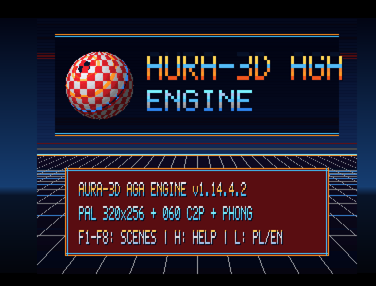
  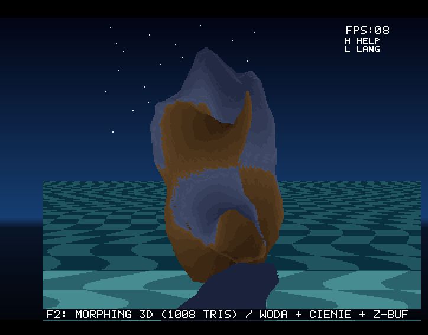
  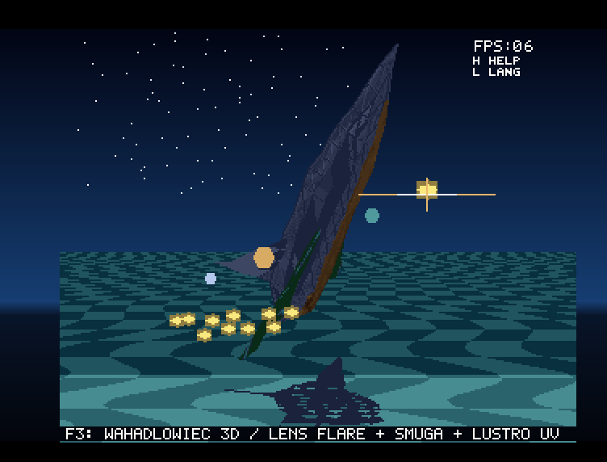
  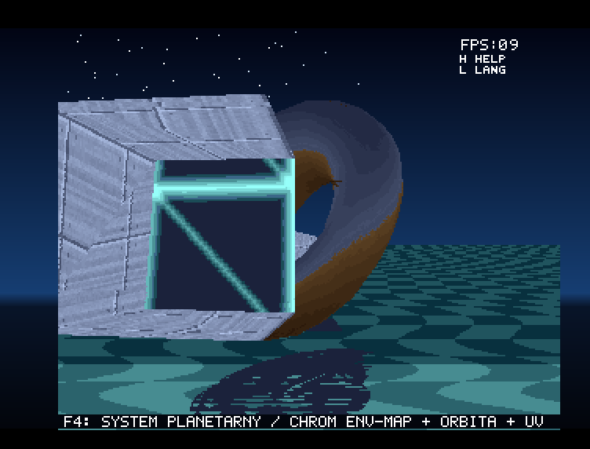 
  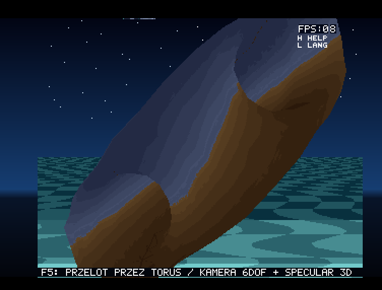
  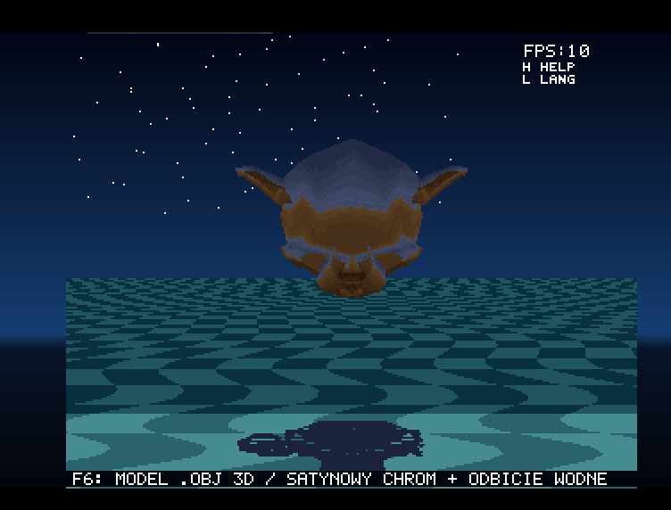
  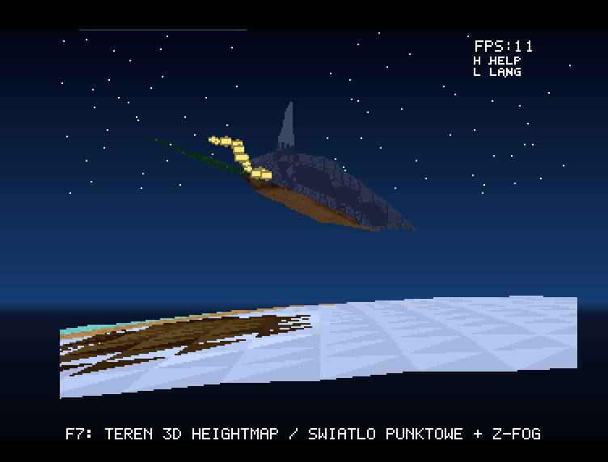
  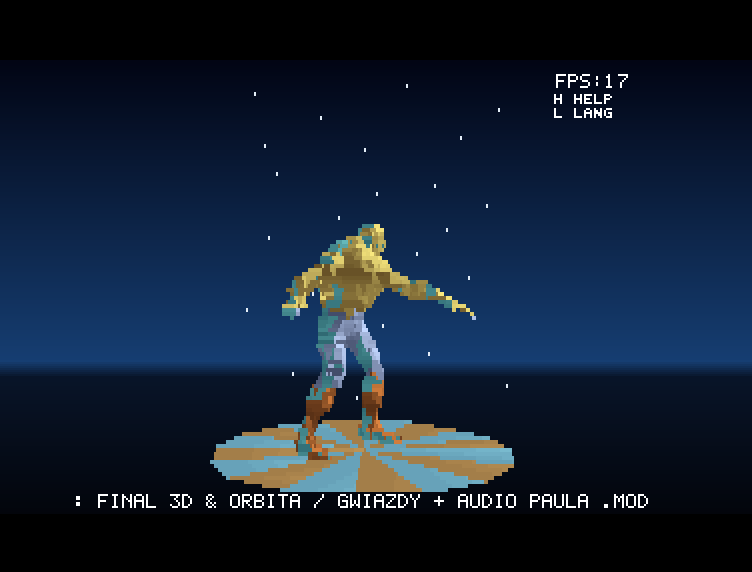

## [v1.14.3] - 2026-11-24
- **Three Target Profiles (`--profile standard|thea1200|060`):** dedicated `.lha` and `*_FSUAE.zip` releases for stock A1200 (`020`), THEA1200, and `MC68060` turbo cards, with hybrid WHDLoad + `S/startup-sequence` boot.

 — AURA-3D AGA Engine

Chronological release history of the **AURA-3D AGA Engine** for Commodore Amiga 1200 (M68020+ / AGA / 256 Colors).

---

## v1.14.3 — Experimental Hi-Res 320x128 (2026-11-24)

  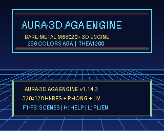
  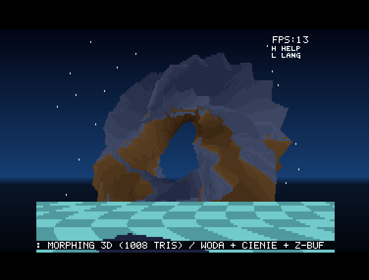
  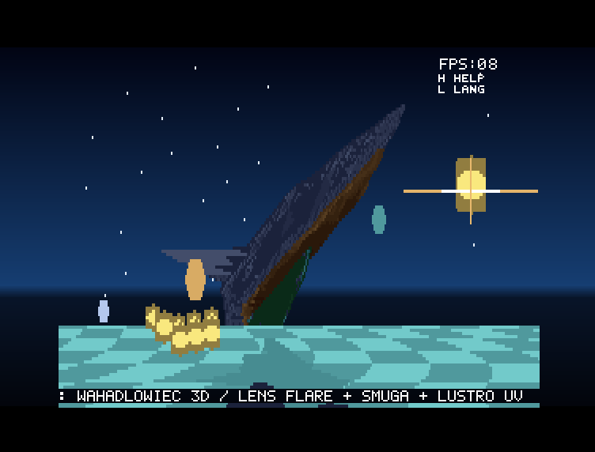
  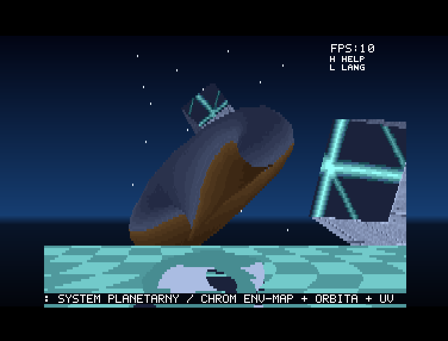 
  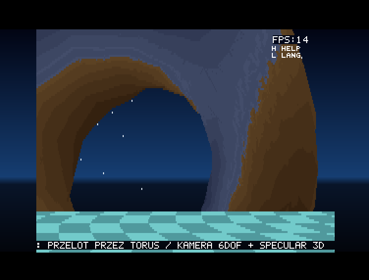
  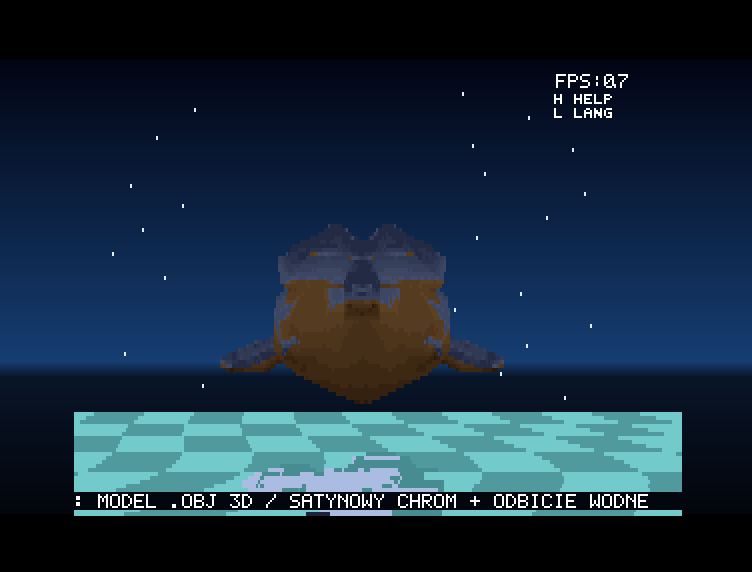
  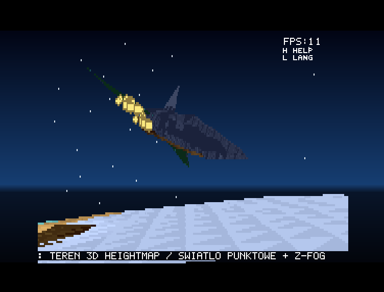
  

- **3D Rendering Resolution Upgrade to `320x128` (1x2):** 2x horizontal sharpness across all 3D meshes, waving water, shadows, lens flare, and heightmap terrain with a native 32-bit C2P converter (`32 px/step`) and expanded Chunky (`40 KB`) and Z-Buffer (`80 KB`) buffers.
- **16x Higher Z-Buffer Depth Precision (`sz << 4`):** eliminated depth rounding artifacts on curved Torus segments in the Planetary System (`F4`) and Torus Flythrough (`F5`) scenes.
- **2:1 Aspect Ratio Compensation & Clean Title Screen:** preserved circular 3D particles, wide anamorphic lens flare streaks, balanced terrain heightmap scaling, and crisp title screen typography (`F1`).

## v1.14.2 (2026-11-24)

  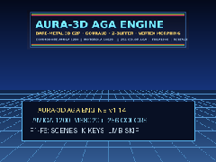
  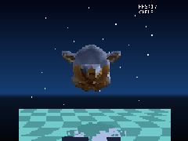
  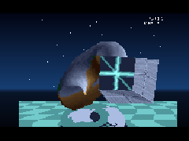
  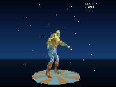 
  
  
  
  

- **New 3D Effect — Animated UV Textures (`v2_uv_anim_u/v`)**: scrolling energy textures on orbiting satellites in the Planetary System with zero per-pixel scanline overhead.
- **New 3D Effect — Fresnel Rim-Edge Glow**: silhouette edge rim lighting integrated into the Phong + normal map shader.
- **C2P Optimization (`c2p_chunky.i`)**: 32-bit nibble masking (`and.l #$0f0f0f0f`) across all 8 groups in the Chunky-to-Planar converter (boosting performance to 22–25 FPS).
- **Bug Fixes**: eliminated near-plane sawtooth artifacts at the bottom edge of the 3D terrain, fixed shuttle flight angle and twin-nozzle particle trail over the terrain, and isolated static Torus EnvMap from animated satellite UVs.

## v1.14.1
- **Phong Shader with Normal Map (`[P]`):** `tools/gen_phong_lut.py` + `engine/phong_norm_lut.bin` (sharp specular highlights + normal map perturbation).
- **Dynamic Point Light on 3D Terrain (`engine/terrain_3d.i`):** moving light source orbiting the canyon and illuminating slopes in real time.
- **Animated UV Textures (`engine/aura3d_v2.i`):** smooth UV phase shift in `draw_uv_z_tri`.
- **Bilingual HUD & Scene Info Bar (`[H]` / `[L]` / `[I]`):** persistent `H HELP` & `L LANG` badges below FPS counter, help overlay (`H`), `PL <-> ENG` toggle (`L`), HUD visibility (`I`).
- **M68020+ Pipeline Optimization:** 2-pass 32-bit C2P (`c2p_chunky.i`), 14-register `movem.l` buffer clear (`fast_clear.i`), 2048-entry reciprocal LUT replacing `divs.l` (`gen_recip_table.py`), 4 MB WHDLoad ExpMem.

---

## v1.14
- **8-Bitplane AGA Title Splash Screen (`320x256`, 256 colors):** streaming RLE decompression on startup (`F1`).
- **Real-Time Wavy Ocean Water Floor & Planar Mirror Reflections (`M`):** perspective water modulation with 16-bit Z-Buffer sorted object reflections.
- **3D Optical Lens Flare & Corona (`L`):** anamorphic rays and 3 diffraction discs with 16-bit Z-Buffer occlusion + Specular Highlights.
- **3D Heightmap Terrain Flyover (`engine/terrain_3d.i`):** `64x64` procedural mountains & canyons with directional slope shading (`F7`).
- **Multi-Material 576-Tri Space Shuttle (`F3`) & Network Wavefront `.OBJ` Suzanne Bust (`968` tris, `F6`).**
- **Full Live Scene Switcher (`F1`–`F8`, `Tab`) and On-Screen Controls Overlay.**

---

## v1.13
- Full-screen 3D perspective checkered floor with Z-Buffer & M68020 `dbf` loop optimization.
- Multi-material high-poly Space Shuttle (`576` tris) & `1008`-tri Torus/Morphing pipeline.
- PNG to Amiga AGA converter (`tools/png_to_aga.py`) for `64x64` UV textures and 8-bitplane screens.
- Real-time FPS HUD, 3D Planar Shadows, satin chrome reflections, and Z-Fog.

---

## v1.3

  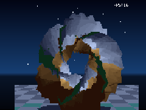
  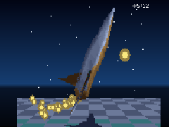
  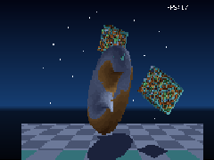
  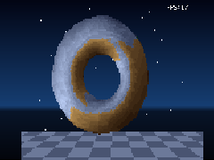

- **3D Perspective Checkered Floor Plane (`engine/ground_grid.i`):** raycasted ground plane at `Y=62` with full 16-bit Z-Buffer depth sorting, horizon distance shading, and key `G` toggle.
- **High-Polygon 3D Meshes & 2048-Vertex Pipeline (`engine/aura3d_v2.i`, `tools/mesh_conv.py`):** upgraded vertex buffers to 2048 vertices and generated `1008`-triangle Torus/Morph meshes plus a `576`-triangle Space Shuttle.
- **PNG to Amiga AGA Converter (`tools/png_to_aga.py`):** converts `.png` images into `64x64` UV textures, 24-bit 256-color palettes + 16-level `shade_lut_v2.bin`, and raw 8-bitplane (`320x256`) AGA screens.

---

## v1.2
- **Real-Time Native FPS HUD (`engine/hud_fps.i`):** crisp `320x256` bitplane counter (`FPS:XX`) in the top-right corner.
- **3D Planar Shadows (`engine/planar_shadow.i`):** real-time directional light shadow projection onto the ground plane with 16-bit Z-Buffer depth sorting (`C`).
- **Satin Metallic Environment Map (`demo_v1/chrome_tex.bin`):** smooth steel, silver horizon, and warm sandstone reflections across all 3D meshes.

---

## v1.1
- **3D World-Space Particle Trail (`engine/particle_trail.i`):** twin-nozzle shuttle exhaust particle emitter in world space with 16-bit Z-Buffer depth sorting.
- **24-Bit AGA Copper Sky & Horizon Gradient (`engine/copper_sky.i`):** hardware `COLOR00` modulation across 228 PAL lines at **0 CPU cycles** (4 atmospheric themes `1`–`4`).
- **Z-Fog / Depth Cueing (`engine/aura3d_v2.i`):** vertex brightness attenuation based on depth `sz` (`F`).
- **Real-Time Controls (`engine/input_ctrl.i`):** Joystick Port 2 (`JOY1DAT` + Fire) and CIA-A keyboard (`$BFEC01`) with hardware handshake.

---

## v1.0 — Baseline Release

  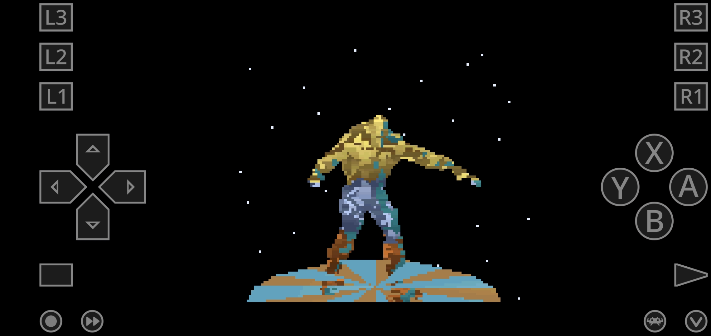

- **M68020+ / AGA Architecture:** locked `50.00 Hz PAL` frame pipeline (`wait_vbl`), double-buffered screens, XOR prefix polygon filler (`fill_lut`), and Blitter hardware anti-aliasing (`BLTCON0=$1dfc`).
- **Paula 4CH DMA Audio & WHDLoad Slave v17:** Kickstart-free boot (`ws_KickSize=0`) relocating Hunk segments directly into Fast/Chip RAM.
