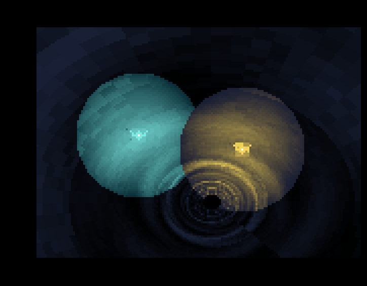
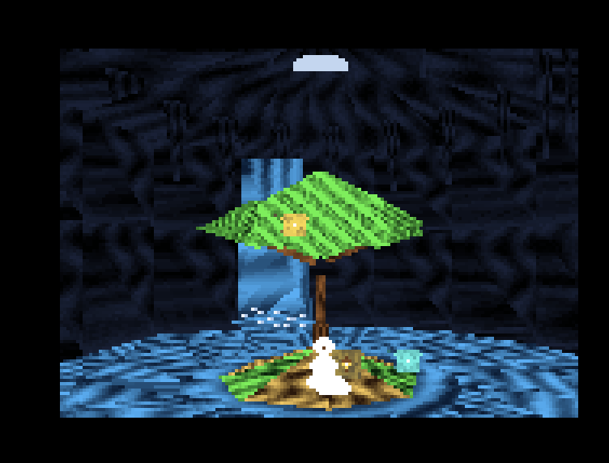

# Amiga 1200 / THEA1200 AGA 3D UV Engine — Grotto 3D v1.0

**Authors / Autorzy:** malek69 & Gemini AI (2026)  
**Platform:** Commodore Amiga 1200 (MC68020+ / AGA / 2 MB Chip + Fast RAM) & THEA1200  
**Music:** *1991-Not A Number* (ProTracker 4-ch MOD)

| Act I — 3D UV Tunnel | Act III — 256-Color 3D Cave |
| :---: | :---: |
|  |  |

## 1. Specyfikacja silnika / Engine Specs (v1.0)
* **Tryb graficzny / Graphics:** `256 kolorów AGA` (`BPLCON0 = $0210`, 8 bitplanów, 24-bitowa paleta RGB ładowana przez `BPLCON3`).
* **Rozdzielczość / Resolution:** `160x128` 8-bit chunky konwertowane w czasie rzeczywistym (C2P) do `320x256` PAL (kinowy kadr `16:9` z czarną obwódką) w `50 Hz`.
* **Wydajność i geometria / Performance:** `20 480` cieniowanych tekseli/klatkę w tunelu oraz `295` oteksturowanych trójkątów 3D UV (`64x64`) w jaskini.

## 2. Sceny demoscenowe / Demo Scenes (`src/demo_scenes.i`)
* **Act I (`scene_01_tunnel`):** Okrągły tunel 3D oparty na tablicy polarnej `224x192` (`tunnel_lut.bin`), dwa świetliki (złoty + turkusowy) ze smugami światła oraz rozszerzający się czarny wylot.
* **Act II (`scene_02_cave_emerge`):** Przejście w mroku — oba świetliki wlatują z tunelu do ciemnej jaskini.
* **Act III (`scene_03_cave_360`):** Kamera orbitalna `360°` wokół jaskini (`295` trójkątów UV): skalne ściany, stalaktyty, 3-pierścieniowe jezioro, animowany wodospad z mgiełką, piaskowo-zielona wyspa, drzewo liściaste, siedząca rusałka z latarnią, dwa świetliki oraz owalny otwór w suficie ze snopem światła.

## 3. Kontener zasobów / Asset Container (`src/grotto_assets.pak` — `103 480 B`)
* Nagłówek `PAK0` + 32-bitowa tablica offsetów spakowana narzędziem `tools/pack_scenes.py`:
  * `PAL256` (`1 024 B`): 256-kolorowa paleta 24-bit RGB (8 banków po 32 odcienie: skały, złoto, zieleń liści, piasek, woda, kora, turkus, poświata).
  * `UVTEX64` (`16 384 B`): 4 proceduralne tekstury `64x64` (skała, woda/wodospad, liście, aura).
  * `TUNLUT` (`86 016 B`): tablica polarna `(kąt U, głębia 1/Z)` `224x192` z marginesem `+-32 px` na kołysanie kamery.

## 4. Moduły i funkcje / Modules & Functions
* `src/main.s`: `start`, `mainloop`, `shutdown` — przejęcie systemu, pętla VBL `50 Hz`, układ sekcji Chip/Fast RAM.
* `src/gfx_engine.i`: `sys_takeover`, `build_copper`, `swap_buffers`, `load_aga_256_palette` — 8 bitplanów AGA, podwójne buforowanie, 24-bit RGB.
* `src/c2p_chunky.i`: `c2p_160x128_to_aga`, `draw_uv_tri`, `scan_uv_edge` — 8-bitplanowy C2P i rasteryzator trójkątów UV `64x64`.
* `src/realtime_3d.i` & `src/demo_scenes.i`: `render_realtime_3d`, `proj_uv_160`, `render_256_mesh`, `draw_256_sunbeam`, `draw_256_rusalka_lantern`, `draw_256_firefly`.
* `src/pt_player.i` & `src/whdload_slave.s`: 4-kanałowy odtwarzacz ProTracker Paula DMA oraz WHDLoad v17+ slave.
* `tools/pack_scenes.py` & `tools/build_grotto3d.py`: paker `PAK0`, kompilacja `vasmm68k_mot` i budowa `releases/grotto3d.lha`.

## 5. Haki sprzętowe AGA / M68020 (Hardware Hacks)
1. **8-Bitplane Table C2P (`c2p_160x128_to_aga`):** Konwersja 4 pikseli naraz przez tablicę `c2p_exp` do `BPL1..BPL8` z podwajaniem linii w pionie (`40(a1)`).
2. **24-Bit AGA Palette Bank Switching (`load_aga_256_palette`):** Ładowanie 256 kolorów 24-bitowych przez przełączanie 8 banków i bitu `LOCT` w `BPLCON3 ($dff106)`.
3. **Zero-Trig Camera Sway (`TUNLUT`):** Przesuwanie wskaźnika w tablicy `224x192` zamiast obliczeń trygonometrycznych na piksel.
4. **Chip RAM Pinning & Copper Sync (`sys_takeover`):** Stałe adresy buforów (`$080000–$0A8000`) i `WAIT $0107,$FFFE` przed zapisem `BPLxPT`.
