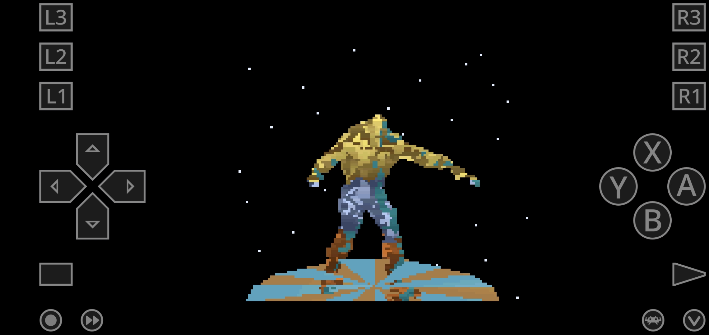

# AURA-3D AGA Engine v2.0 (Amiga 1200 / THEA1200)

Bare-metalowy **silnik 3D** dla **Amigi 1200 (AGA / Motorola 68020+)**, **THEA1200** oraz emulatorów (**FS-UAE / Amiberry / RetroArch PUAE**).

## Możliwości silnika AURA-3D v2.0 (`engine/aura3d_v2.i`)
- **Pełny potok 3D M68020+:** Macierze obrotu Eulera 3×3 (Yaw / Pitch / Roll), transformacje wieloobiektowe w przestrzeni świata oraz rzutowanie perspektywiczne.
- **16-bitowy Z-Buffer w Fast RAM:** Sortowanie głębi piksel po pikselu eliminujące błędy przenikania się wklęsłych siatek i wielu obiektów 3D naraz.
- **Teksturowanie UV 64×64×256 kolorów:** Rasteryzator trójkątów ze zoptymalizowaną rejestrową pętlą wewnętrzną pod 68020 i konwersją **Chunky-to-Planar (C2P)** AGA.
- **Gouraud Shading + Environment Mapping:** Oświetlenie kierunkowe (`N · L`) z płynną interpolacją jasności po wierzchołkach (16-poziomowa tablica `shade_lut_v2` w palecie 256 kolorów AGA) oraz odbicia metalicznego chromu.
- **Narzędzia deweloperskie (`tools/`):**
  - `tools/mesh_conv.py` — konwerter modeli Wavefront `.obj` oraz generator brył 3D z wygładzonymi normalnymi wierzchołków.
  - `tools/build_demo.py` — automatyczny kompilator (`vasmm68k_mot`) i generator archiwów WHDLoad `.lha` (`_AGA` + standardowa ikona AmigaOS `DiskObject`).

## Struktura repozytorium
- **`engine/`** — kod asemblera M68020+ (`aura3d_v2.i`, `c2p_chunky.i`, `gfx_engine.i`, `pt_player.i`, `whdload_slave.s`).
- **`demo_v1/`** — sceny 3D, siatki wielokątów, tekstury 64×64, tablice cieniowania AGA i moduł muzyczny `.MOD`.
- **`tools/`** — skrypty Python do konwersji modeli `.obj` i pakowania wydań `.lha`.
