
<a href="README.md">Polski</a> | <strong>English</strong> | <a href="CHANGELOG_EN.md">Changelog</a>

  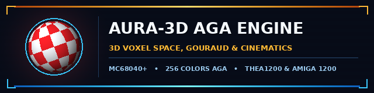
  <h1>AURA-3D AGA Engine v1.15.0</h1>
  
<strong>Bare-metal 3D Software Engine for Commodore Amiga 1200 (M68020+ / AGA / 256 Colors)</strong>

  

    <a href="https://github.com/malek69/aura3d-aga-engine/releases/download/v1.15.0/aura3d_demo_v2_AGA_THEA1200.lha">Download .LHA</a> &bull;
    <a href="https://github.com/malek69/aura3d-aga-engine/releases/download/v1.15.0/aura3d_demo_v2_AGA_THEA1200_FSUAE.zip">Download FS-UAE .ZIP</a> &bull;
    <a href="https://github.com/malek69/aura3d-aga-engine/releases/download/v1.15.0/aura3d_demo_v1.15.0_AGA.adf">Download .ADF</a> &bull;
    <a href="https://github.com/malek69/aura3d-aga-engine/releases/download/v1.15.0/aura3d-aga-engine-v1.15.0-src.zip">Source .ZIP</a>
  

---

## Target Platform (v1.15.0) & Other Hardware Support

Starting with **`v1.15.0`**, all new engine modules (`voxel_space.i`, `cinematic_fx.i`, `thea1200_hw.i`, `flight_ctrl.i`, and the 32-bit `FULL_RES` C2P pipeline) are developed **exclusively for the THEA1200 architecture (`MC68040 + Fast RAM + AGA`, full PAL `320×256`, 256 colors)**.

- **Compatible setups for the full `v1.15.0` engine:**
  - **THEA1200** console (native `--profile thea1200` build).
  - **Real Amiga 1200 / Amiga 4000 (AGA)** equipped with an **`MC68040` or `MC68060` accelerator** and **Fast RAM** (via `.LHA` / WHDLoad).
  - **Amiberry**, **FS-UAE**, and **WinUAE** configured as `A1200 + 68040/060 + Fast RAM + AGA`.
- **What about other platforms:**
  - **Stock Amiga 1200 (`68EC020` without Fast RAM):** limited strictly to the legacy `320×128` demo profile (`--profile standard`) without the `v1.15.0` expansion modules.
  - **Amiga 500 / 600 (`OCS/ECS`):** not supported (the engine requires the 256-color **AGA** chipset and an **M68020+ / M68040** CPU).

## Downloads (v1.15.0 — Hardware Profiles)

Profile (`--profile`) | Target Hardware | Engine Feature Set | Packages
---|---|---|---
**THEA1200 (`--profile thea1200`)** *(primary)* | **THEA1200**, **A1200/A4000 + 68040**, **Amiberry**, **FS-UAE** (`320×256 AGA`) | **Full `v1.15.0` Engine** (Voxel Space 3D, Gouraud, Cinematics, 32-bit C2P) | [.LHA](docs/Aura3D_AGA_THEA1200.lha) · [.ZIP (FS-UAE/WinUAE)](docs/Aura3D_AGA_THEA1200_FSUAE.zip)
**Turbo MC68060 (`--profile 060`)** | Amiga 1200/4000 with **MC68060** accelerator (`320×256 AGA`, `-m68060`, 50 Hz) | **Full `v1.15.0` Engine** (THEA1200 compatible + `060` superscalar path) | [.LHA](docs/Aura3D_AGA_060.lha) · [.ZIP (FS-UAE/WinUAE)](docs/Aura3D_AGA_060_FSUAE.zip)
**Standard 020 (`--profile standard`)** *(legacy)* | Stock **Amiga 1200 (`68EC020`)**, **RetroArch** (`320×128`) | Legacy `F1–F8` demo scenes only (`v1.14.x`, excludes `v1.15.0` modules) | [.LHA](docs/Aura3D_AGA_020.lha) · [.ZIP](docs/Aura3D_AGA_020_FSUAE.zip) · [.ADF](docs/Aura3D_AGA_Demo.adf)

### Package Variants & Compatibility
- **`.lha` (WHDLoad + zapasowy `S/startup-sequence`):** działa od strzała w **RetroArch (`PUAE`)**, **Amiberry** (nawet bez pliku `C:WHDLoad`), **THEA1200** oraz na prawdziwej **Amidze 1200**.
- **`_FSUAE.zip`:** gotowy dysk twardy `DH0:` z auto-bootem dla **FS-UAE** i **WinUAE**.

---

## Gallery (8 Stages on the Real AGA Pipeline)

<table>
  <tr>
    <td align="center">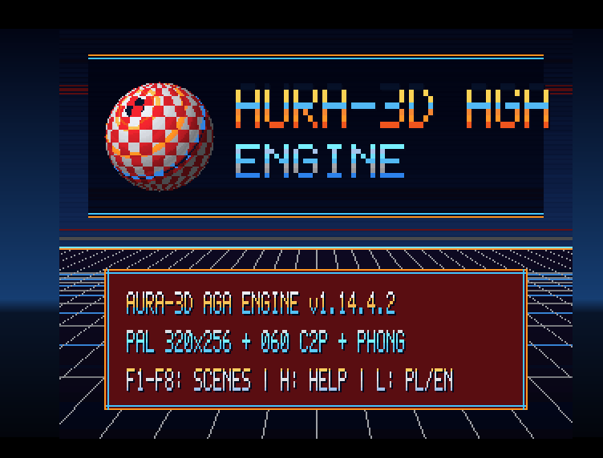 <b>1. AGA Title Screen</b> (8-Bitplane RLE)</td>
    <td align="center">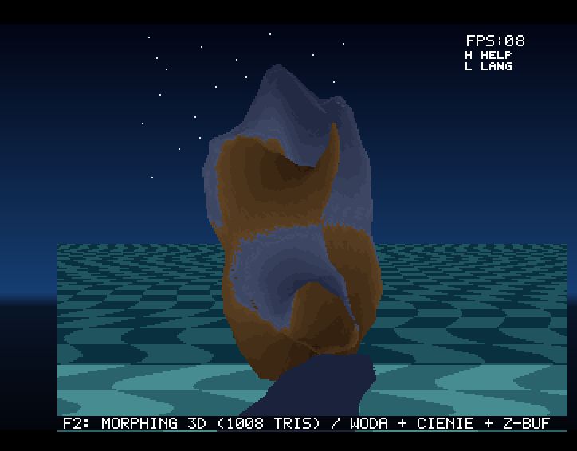 <b>2. 3D Vertex Morphing</b> (1008 Triangles)</td>
    <td align="center">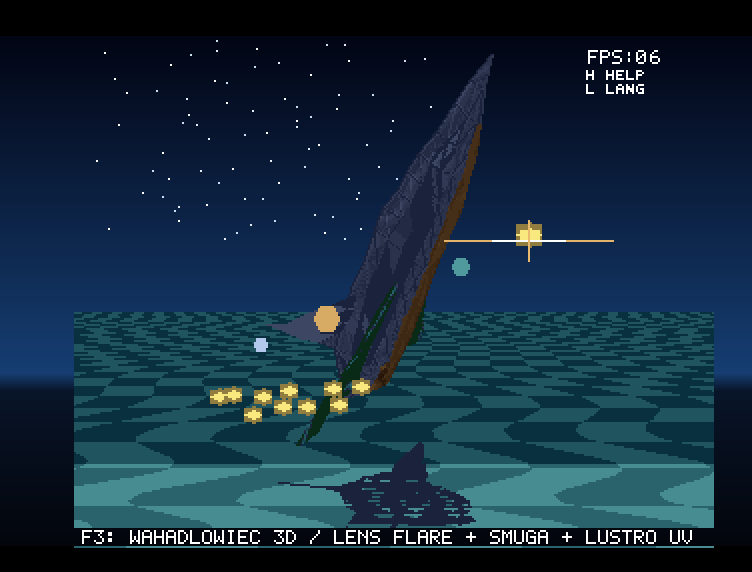 <b>3. 3D Shuttle + Lens Flare</b> (576 Tris)</td>
    <td align="center">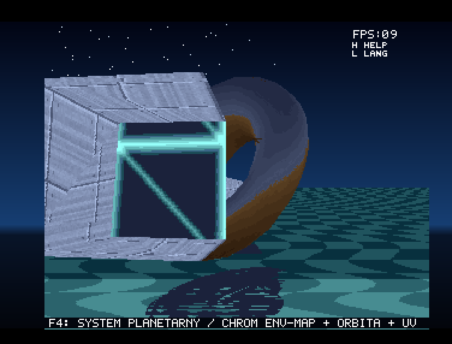 <b>4. Planetary System</b> (1008-Tri Chrome + UV)</td>
  </tr>
  <tr>
    <td align="center">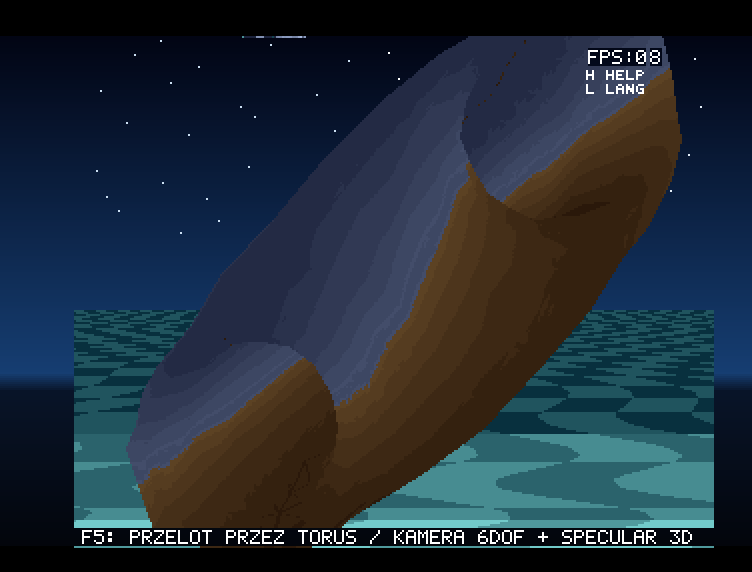 <b>5. Torus Flythrough</b> (6DOF Camera)</td>
    <td align="center">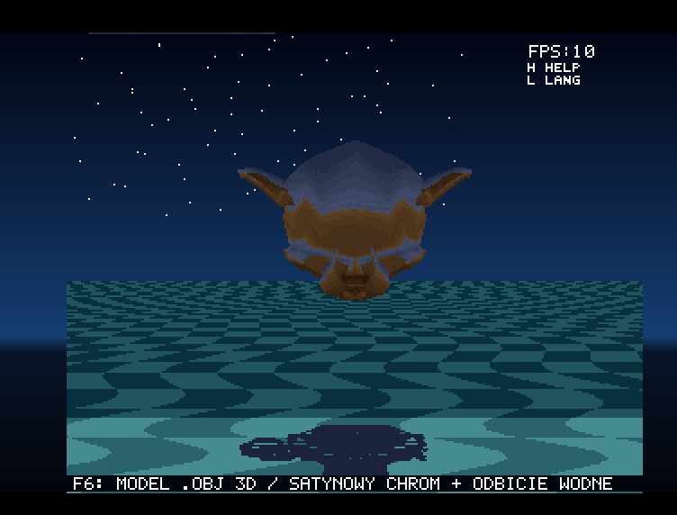 <b>6. Wavefront .OBJ Suzanne</b> (968 Triangles)</td>
    <td align="center">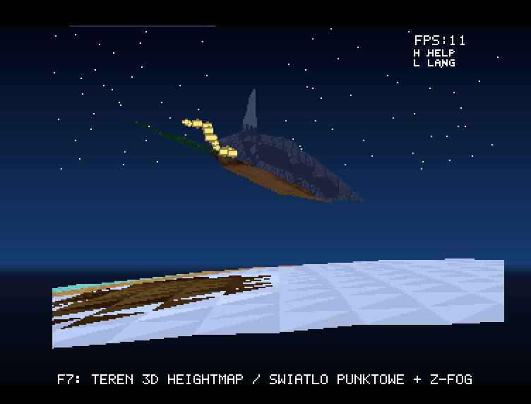 <b>7. 3D Heightmap Terrain</b> (Point Light + Z-Fog)</td>
    <td align="center">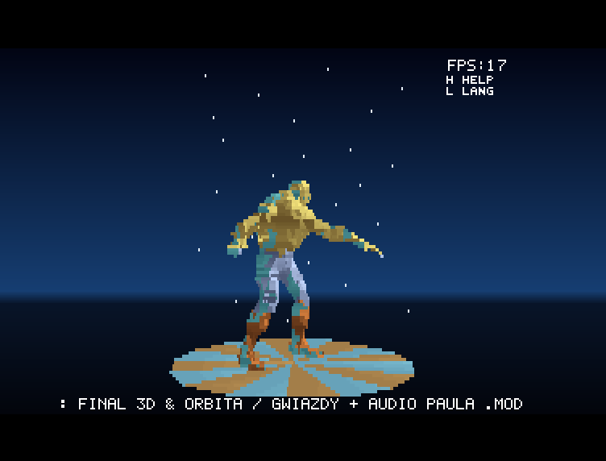 <b>8. 3D Finale &amp; Orbit</b> (Vector Character)</td>
  </tr>
</table>

---

## Engine Features (v1.15.0)

- **8-Bitplane AGA Title Screen (`320x256`, 256 Colors):** converted from `.png` via `tools/png_to_aga.py` with streaming RLE decompression.
- **Waving Water Surface & Planar Reflections (`M`):** perspective water scanlines with sinusoidal wave modulation and 16-bit Z-Buffer sorted reflections.
- **3D Lens Flare (`K`):** anamorphic light streaks and 3 diffraction discs with Z-Buffer occlusion testing.
- **Specular Highlights:** sharp metallic light reflections (`transform_normals_envmap` optimized with M68020 `bfextu`).
- **3D Heightmap Terrain (`engine/terrain_3d.i`):** procedural `64x64` heightmap canyon with directional slope shading, dynamic point light, lakes, and peaks.
- **Multi-Material 3D Meshes + `.obj` / `.png` Converters:** up to four `64x64` textures per mesh (`tools/mesh_conv.py` and `tools/png_to_aga.py`).
- **24-Bit Copper Sky (`1`-`4`), Planar Shadows (`C`), Depth Z-Fog (`F`), Phong + Fresnel Rim Glow (`P`), Animated UV, Dynamic Point Light & Bilingual HUD (`H`, `L`, `I`).

---

### Engine v1.15.0 Live Showcase (THEA1200 — 320×256 AGA)

| 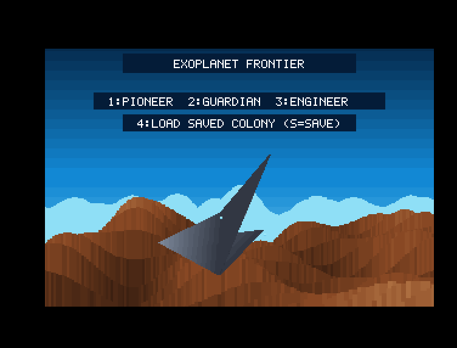 | 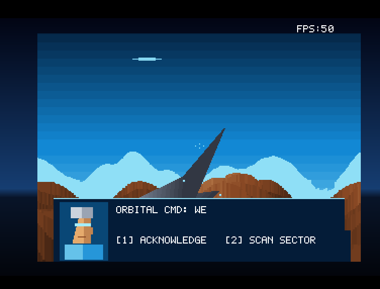 | 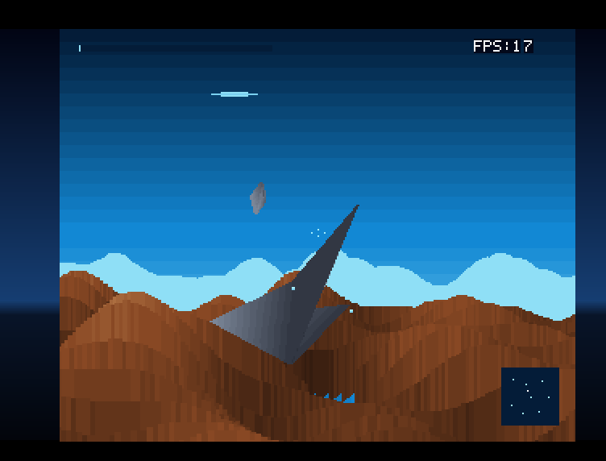 |
|:---:|:---:|:---:|
| **1. Cinema Letterbox & 24-Bit AGA Fade** | **2. Narrative & Portrait Engine (`cinematic_fx.i`)** | **3. 360° Voxel Space, Water & Gouraud 3D Meshes** |

## Scene Breakdown (`F1`–`F8` & `Tab`)

| Key | Scene | Content & Active Effects |
| :--- | :--- | :--- |
| **`F1`** | **AGA Title Screen** | `320x256` 8-bitplane (256-color) splash screen decompressed from RLE |
| **`F2`** | **Scene 1: 3D Vertex Morphing** | Smooth `1008`-triangle mesh morphing (Torus <-> Sphere <-> Star) over waving water with shadows |
| **`F3`** | **Scene 2: Multi-Material Shuttle** | `576`-triangle model (titanium, cyber-circuits, thermal shield), twin-nozzle trail, Lens Flare (`K`), and water reflection (`M`) |
| **`F4`** | **Scene 3: Planetary System** | Central Torus (`1008` triangles, satin chrome) + 2 orbiting satellites with animated UV textures over waving water |
| **`F5`** | **Scene 4: Torus Camera Flythrough** | Full 6DOF 3D camera flying through the center of a `1008`-triangle chrome Torus |
| **`F6`** | **Scene 5: Wavefront `.OBJ` Model (Suzanne)** | `968`-triangle mesh imported from `.obj` via `tools/mesh_conv.py` rendered in satin chrome + Fresnel Rim Glow |
| **`F7`** | **Scene 6: 3D Heightmap Terrain Flyover** | Procedural `64x64` heightmap terrain with dynamic point light, depth Z-Fog, and flying shuttle |
| **`F8`** | **Scene 7: 3D Finale & Orbit** | Classic 3D vector character on a rotating platform, starfield, and 4-channel ProTracker `.MOD` music |

---

## Controls (`H` Help, `L` Lang PL/EN, `P` Phong, `I` HUD)

| Key / Controller | Action |
| :--- | :--- |
| **`F1` – `F8`** | Jump directly to any scene (from title screen to 3D finale) |
| **`Tab`** | Cycle to the next scene |
| **`H`** | Toggle on-screen **Help Overlay (HELP)** |
| **`L`** | Switch language **PL / ENG** (Help + Scene Info) |
| **`P`** | Toggle **Phong + Fresnel Rim Glow Shader** |
| **`Arrow Keys` / Joystick Port 2** | Rotate camera and 3D objects (`Yaw` / `Pitch`) |
| **`W` / `S` or `Fire + Up/Down`** | Camera zoom in / out (`Zoom`) |
| **`1` – `4`** | Switch 24-bit Copper sky theme (Night, Sunset, Aurora, Nebula) |
| **`M`** | Toggle **3D Water Mirror Reflections** |
| **`K`** | Toggle **3D Lens Flare** |
| **`G`** | Toggle **Waving Water / 3D Ground Floor** |
| **`C`** | Toggle **3D Planar Shadows** |
| **`F`** | Toggle **Depth Z-Fog** |
| **`I`** | Toggle **FPS Counter & Info Bar (HUD)** |
| **`Space` / `R`** | Reset camera orientation and zoom |
| **`LMB` / `ESC`** | Exit cleanly back to AmigaOS / WHDLoad |

---

## Engine Architecture & Modules (`engine/`)

| Module | Role in Engine | Hardware Mechanisms & Algorithms |
| :--- | :--- | :--- |
| **`gfx_engine.i`** | AGA & Copper Initialization | System takeover (`sys_takeover`), 8 bitplanes (`320x256`, 256 colors), `50 Hz` VBL double buffering, 24-bit Copper sky (`1`-`4`) |
| **`c2p_chunky.i`** | Chunky-to-Planar Converter | Real-time 32-bit conversion of `320x128` 8-bit chunky buffer into 8 AGA bitplanes (`320x256`) on M68020+ |
| **`aura3d_v2.i`** | Core 3D Pipeline & Rasterizer | 3D matrix transforms, perspective projection, Gouraud + UV (`bfextu`), Phong + Fresnel Rim Glow, animated UV, `Z-Fog`, 16-bit **Z-Buffer** |
| **`ground_grid.i`** | Waving 3D Water Surface | Perspective scanline water renderer with sinusoidal modulation (`sin_tab`), Z-scrolling, and Z-Buffer writes (`G`) |
| **`mirror_reflect.i`** | 3D Planar Reflections | Mirrored vertex projection across the water plane with surface masking and Z-Buffer depth testing (`M`) |
| **`planar_shadow.i`** | 3D Cast Shadows | Ground-plane shadow projection with Z-Buffer depth sorting (`C`) |
| **`lens_flare.i`** | 3D Lens Flare | Light source projection, Z-Buffer occlusion test, anamorphic streaks, and diffraction discs (`K`) |
| **`voxel_space.i`** | 3D Heightmap Terrain | Procedural `64x64` heightmap generator, directional slope shading, dynamic point light, and `Z-Fog` |
| **`particle_trail.i`** | 3D Particle System | World-space twin-nozzle exhaust emitter with lifetime fade in Z-Buffer |
| **`starfield.i`** | 3D Starfield Background | 256 multi-layer depth-parallax stars |
| **`hud_fps.i`** | Bilingual HUD & Help | `50 Hz` VBL frame rate counter (`FPS:XX`, key `I`), `PL/ENG` switcher (`L`), and help overlay (`H`) |
| **`input_ctrl.i`** | Keyboard & Joystick Input | Direct hardware reading of CIA-A (`$BFEC01` + `ACK` pulse) and Joystick Port 2 (`JOY1DAT` + `Fire`) |
| **`voxel_space.i`** | 360° Voxel Space 3D Terrain | Incremental 68040 raymarching (`vx_row_lut`), dynamic horizon pitch (`cam_pitch`), 320-column depth buffer (`vx_ybuf`), and animated water reflections |
| **`cinematic_fx.i`** | Cinematic & Dialogue Engine | Cinema letterbox bars, typewriter dialogue panel, animated character portrait renderer, and smooth camera interpolation |
| **`thea1200_hw.i`** | THEA1200 Hardware & AGA Palette | 24-bit 8-bank AGA palette fader & mood tinting (`BPLCON3`), mouse (`$DFF00A` + LMB), and multi-button gamepad (`$DFF016`) hot-swap |
| **`flight_ctrl.i`** | 360° 3D Flight Controller | Smooth 360° yaw with wing bank, horizon pitch (`cam_pitch`), and terrain collision floor protection |
| **`pt_player.i`** | ProTracker Music Player | 4-channel Paula audio DMA `.MOD` replayer (`16,497 Hz`) |

---

## Developer Tools (`tools/`)

- **`tools/mesh_conv.py`** — converts Wavefront **`.obj`** 3D models into native M68k assembly vertex, normal, and triangle tables (`--obj`, `--prefix`, `--out`, `--radius`, `--tex`).
- **`tools/png_to_aga.py`** — converts **`.png`** images into `64x64` chunky textures (`--mode texture`) or full-screen `320x256` 8-bitplane AGA images with 24-bit palettes (`--mode bitplanes`).
- **`tools/build_demo.py`** — automated build script assembling the M68020+ executable (`vasmm68k_mot`), WHDLoad Slave, and packaging **`.adf`**, **`.lha`**, and **`_FSUAE.zip`** releases.
